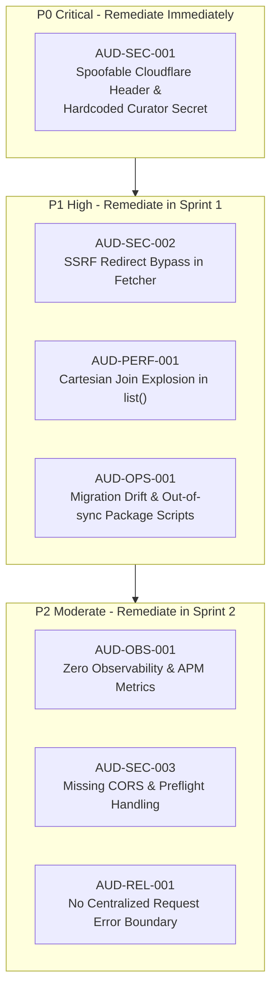

# 00 — Executive Summary & System Verdict

## System Identity & Overview
- **Project Name:** Pilot ("HUMAN AFTER ALL!" AI Resource Hub)
- **Domain:** AI Engineering & Productivity Resource Directory & Workflows Catalog
- **Production URL:** `https://pilot.nodbits.com`
- **Active Deployment:** Cloudflare Workers (Edge Runtime) + Cloudflare D1 (SQLite Engine) + Cloudflare Static Assets
- **Audit Date:** October 2026
- **Auditor Roles:** Principal Software Architect, Staff+ Engineer, Security Auditor, Site Reliability Engineer, Data Architect, UX Lead

---

## Production Readiness Verdict

```
+-----------------------------------------------------------------------+
|                      PRODUCTION READINESS VERDICT                     |
|                                                                       |
|                         CONDITIONALLY READY                           |
+-----------------------------------------------------------------------+
```

### Rationale
Pilot exhibits strong foundational modular architecture, clean hexagonal domain boundaries, zero framework bloat, and fast edge response times. However, it cannot be classified as fully **READY** due to **one Critical (P0)** security vulnerability and **two High (P1)** architectural risks:
1. **P0 Security Defect (`AUD-SEC-001`):** Insecure Curator Authentication via spoofable header `cf-access-authenticated-user-email` and hardcoded fallback secret `'pilot_curator_secret_2026'` in `src/adapters/http/curatorAuth.ts`.
2. **P1 Security Defect (`AUD-SEC-002`):** Server-Side Request Forgery (SSRF) bypass through redirect following in `FetchToolMetadataUseCase.ts`.
3. **P1 Performance/Scalability Defect (`AUD-PERF-001`):** Multi-table Cartesian product join explosion in `D1ResourceRepository.list()` (`src/adapters/persistence/d1/D1ResourceRepository.ts`).

Once P0 and P1 vulnerabilities are patched and database migration tooling is stabilized, Pilot achieves high production reliability and edge scalability.

---

## System Scorecard Across Key Dimensions

| Engineering Dimension | Score (0-100) | Grade | Status | Notes |
|:---|:---:|:---:|:---|:---|
| **Architecture & Modularity** | **88** | **A-** | **STRONG** | Genuine hexagonal isolation, platform-agnostic domain core, architectural fitness tests. |
| **Portability & Decoupling** | **94** | **A** | **EXCELLENT** | Core domain and application layers have 0 Cloudflare imports. Verified by automated tests. |
| **Data Architecture & Schema** | **78** | **B+** | **GOOD** | Clean relational schemas with FTS5 search; migration tooling currently drifted. |
| **Security & Authorization** | **52** | **D** | **CRITICAL ACTION** | P0 header spoofing & hardcoded token fallback in curator auth; SSRF via redirect. |
| **Reliability & Error Safety** | **75** | **B** | **MODERATE** | Safe fallbacks on client; lack of structured server logging and centralized error boundaries. |
| **Performance & Efficiency** | **82** | **B+** | **GOOD** | Fast edge compute (<30ms global TTFB), but resource search query suffers Cartesian blowup. |
| **Scalability (10x - 50x)** | **70** | **B-** | **NEEDS WORK** | 10x traffic works cleanly; 50x will encounter D1 concurrency saturation and unindexed joins. |
| **Observability & Ops** | **45** | **F** | **WEAK** | Zero distributed tracing, no APM, no metrics instrumentation, stdout only. |
| **Testing & Quality Assurance**| **72** | **B-** | **MODERATE** | 35 passing unit & architectural tests; lacks integration, E2E, and concurrency tests. |
| **Frontend & UX / Accessibility**| **80** | **B+** | **GOOD** | Vanilla JS, ultra-fast render, clean keyboard nav; lacks full ARIA live-regions on search. |
| **Overall Engineering Maturity** | **74 / 100** | **B** | **CONDITIONALLY READY** | Solid architectural foundation needing enterprise security and operational hardening. |

---

## Top Systemic Findings Summary



---

## Key Recommendations for Engineering Leadership
1. **Immediate Quarantine & Hotfix (Within 24 Hours):**
   - Eliminate hardcoded fallback secret in `src/adapters/http/curatorAuth.ts`.
   - Disable raw header trust for `cf-access-authenticated-user-email` unless verified with Cloudflare Access JWT validation (`cf-access-jwt-assertion`).
   - Use `crypto.timingSafeEqual` for all token comparisons.
2. **Database & Query Hardening (Within 1 Week):**
   - Rewrite `D1ResourceRepository.list()` to avoid joining `workflow_steps` (1:N) and `resource_tags` (1:M) simultaneously without correlated subqueries.
   - Synchronize database migrations with `wrangler d1 migrations apply` and fix `package.json` migrate scripts.
3. **Observability & Defense (Within 2 Weeks):**
   - Add Cloudflare Rate Limiting rules to protect `/api/tools/fetch-metadata` from outbound DoS abuse.
   - Set up structured JSON error responses with correlation IDs (`cf-ray` / UUID).
