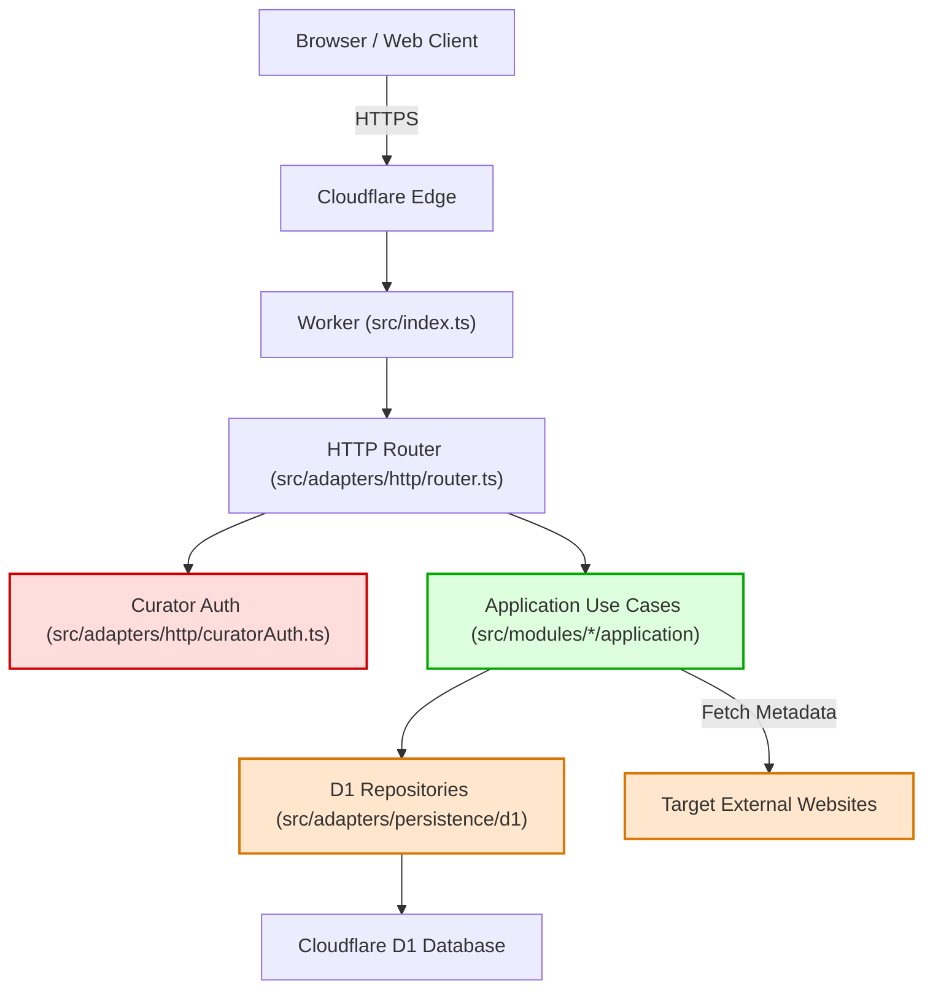

# 02 — System Inventory

## Inventory Matrix

| Component Name | Type | Location | Runtime / Language | Responsibilities | Persistence / State | External Integrations |
|:---|:---|:---|:---|:---|:---|:---|
| **Worker Entrypoint** | Infrastructure | `src/index.ts` | Cloudflare Workers / TS | Incoming HTTP dispatch, dynamic SEO meta injection, security headers (`X-Robots-Tag`). | Stateless | Cloudflare Workers Runtime, Static Assets (`ASSETS`) |
| **HTTP Router Adapter** | Inbound Adapter | `src/adapters/http/router.ts` | Standard Web APIs / TS | Parsing REST endpoints, query parameters, JSON validation, orchestrating application use cases. | Stateless | None (Platform-agnostic `Request`/`Response`) |
| **Curator Auth Adapter**| Security Adapter | `src/adapters/http/curatorAuth.ts` | Standard Web APIs / TS | Authenticates curator/admin role via Bearer tokens, headers, or Cloudflare Access headers. | In-memory token check | Cloudflare Access headers |
| **D1 Persistence Adapters** | Outbound Adapter | `src/adapters/persistence/d1/` | Cloudflare D1 / TS | SQL persistence for resources, prompts, tools, workflows, agents, and FTS5 search queries. | Cloudflare D1 (SQLite) | Cloudflare D1 Database Binding (`DB`) |
| **Core Domain** | Domain Layer | `src/core/domain/Resource.ts` | Pure TypeScript | Universal resource entity, validation, tags, relationships, and origin metadata. | Pure In-Memory | None (Zero external dependencies) |
| **Prompts Module** | Business Module | `src/modules/prompts/` | Pure TypeScript | Prompt domain logic, DTO mapping, prompt CRUD use cases. | D1 (`prompts`, `prompts_fts`) | None |
| **Tools Module** | Business Module | `src/modules/tools/` | Pure TypeScript | Tool/website catalog domain logic, URL normalizer, SSRF host validator, metadata fetcher use case. | D1 (`tools`, `tools_fts`) | External websites (via `fetch` for title/description scraping) |
| **Workflows Module** | Business Module | `src/modules/workflows/` | Pure TypeScript | Multi-step workflow orchestration domain logic, step reordering, difficulty/status validation. | D1 (`workflows`, `workflow_steps`, `workflow_resources`) | None |
| **Agents Module** | Business Module | `src/modules/agents/` | Pure TypeScript | AI agent specifications (identity, role, runtime, contracts, relationships), text exporter. | D1 (`agents`, `agents_fts`, `resource_relationships`) | None |
| **Single-Page Application** | Frontend Client | `public/` (`index.html`, `app.js`, `styles.css`) | Browser Web Platform / ES6+ | Dynamic catalog browser, search filtering, client-side routing, theme switching, curator modals. | Browser `localStorage` (theme, favorites, token) | Pilot REST API (`/api/*`), DuckDuckGo Favicon Service |
| **Database Migrations** | Infrastructure DDL | `migrations/*.sql` | SQLite DDL / FTS5 | Relational table definitions, indices, triggers, and catalog seeds. | Disk / D1 Engine | Cloudflare D1 |

---

## Security & Failure Impact Analysis

- **Critical Security Boundary:** `src/adapters/http/curatorAuth.ts` controls write access to the entire database. If bypassed, malicious users can create, update, or delete all resources.
- **External Dependency Risk:** `FetchToolMetadataUseCase` issues outbound HTTP calls to user-specified domains. Susceptible to outbound SSRF, timeouts, and rate limits.
- **Single Point of Failure (SPOF):** Cloudflare D1 `pilot-db`. If D1 experiences service degradation, all read and write queries degrade to 500 errors unless cached at the edge.
