# 03 — Architecture Audit & Boundaries

## Architecture Style: Hexagonal Modular Monolith

Pilot is designed as a **Modular Monolith** employing **Hexagonal Architecture (Ports and Adapters)**.

```mermaid
flowchart TB
    subgraph Driving_Adapters ["Driving / Inbound Adapters"]
        WorkerEntry["src/index.ts (Cloudflare Worker Fetch Handler)"]
        Router["src/adapters/http/router.ts (Standard Web Request/Response)"]
        CuratorAuth["src/adapters/http/curatorAuth.ts (Auth Guard)"]
    end

    subgraph Application_Layer ["Application Use Cases"]
        CoreDTO["src/core/application/ResourceDto.ts"]
        PromptUC["src/modules/prompts/application/*"]
        ToolUC["src/modules/tools/application/*"]
        WorkflowUC["src/modules/workflows/application/*"]
        AgentUC["src/modules/agents/application/*"]
    end

    subgraph Domain_Layer ["Domain Layer (Platform Agnostic)"]
        CoreDomain["src/core/domain/Resource.ts"]
        PromptDomain["src/modules/prompts/domain/Prompt.ts"]
        ToolDomain["src/modules/tools/domain/Tool.ts"]
        WorkflowDomain["src/modules/workflows/domain/Workflow.ts"]
        AgentDomain["src/modules/agents/domain/Agent.ts"]
    end

    subgraph Ports ["Inverted Ports (Repository Interfaces)"]
        CorePorts["src/core/ports/ResourceRepository.ts"]
        PromptPorts["src/modules/prompts/ports/PromptRepository.ts"]
        ToolPorts["src/modules/tools/ports/ToolRepository.ts"]
        WorkflowPorts["src/modules/workflows/ports/WorkflowRepository.ts"]
        AgentPorts["src/modules/agents/ports/AgentRepository.ts"]
    end

    subgraph Driven_Adapters ["Driven / Outbound Adapters"]
        D1Core["src/adapters/persistence/d1/D1ResourceRepository.ts"]
        D1Prompt["src/adapters/persistence/d1/D1PromptRepository.ts"]
        D1Tool["src/adapters/persistence/d1/D1ToolRepository.ts"]
        D1Workflow["src/adapters/persistence/d1/D1WorkflowRepository.ts"]
        D1Agent["src/adapters/persistence/d1/D1AgentRepository.ts"]
    end

    WorkerEntry --> Router
    Router --> CuratorAuth
    Router --> PromptUC & ToolUC & WorkflowUC & AgentUC
    PromptUC & ToolUC & WorkflowUC & AgentUC --> CoreDomain & PromptDomain & ToolDomain & WorkflowDomain & AgentDomain
    PromptUC & ToolUC & WorkflowUC & AgentUC --> CorePorts & PromptPorts & ToolPorts & WorkflowPorts & AgentPorts
    D1Core -.-> CorePorts
    D1Prompt -.-> PromptPorts
    D1Tool -.-> ToolPorts
    D1Workflow -.-> WorkflowPorts
    D1Agent -.-> AgentPorts
```

---

## Architectural Rule Verification (Evidence)

The project includes an explicit architectural fitness test suite (`tests/portability.test.mjs`) that inspects source files on disk:

1. **Rule 1: Domain & Application layers must contain zero Cloudflare imports or types:**
   - Files checked: All `.ts` files under `src/core/` and `src/modules/`.
   - Forbidden regexes: `/@cloudflare\//`, `/cloudflare:/`, `/\bwrangler\b/`, `/\bD1Database\b/`, `/\bExecutionContext\b/`, `/\bKVNamespace\b/`, `/\bR2Bucket\b/`.
   - **Audit Result: PASS (0 violations).**
2. **Rule 2: HTTP router must not instantiate D1 repositories or import Cloudflare Env:**
   - Inspected file: `src/adapters/http/router.ts`.
   - Repository instances are passed via `RouterDependencies` interface created in `src/platform/cloudflare/bootstrap.ts`.
   - **Audit Result: PASS.**
3. **Rule 3: Cloudflare types restricted strictly to platform and persistence adapters:**
   - Verified that `D1Database` and `Env` exist only in `src/platform/cloudflare/` and `src/adapters/persistence/d1/`.
   - **Audit Result: PASS.**

---

## Architectural Strengths
- **Clean Inversion of Control:** Adding an in-memory repository or standard SQLite / PostgreSQL adapter for Node.js requires zero changes to use cases or domain entities.
- **Portability:** Can run in Node.js, Fastify, Express, Bun, or Deno simply by implementing a platform bootstrap equivalent to `src/platform/cloudflare/bootstrap.ts`.
- **Modular Boundaries:** Cross-module data aggregation (e.g. workflows referencing tools or agents referencing prompts) occurs strictly through `resource_relationships` join tables and public IDs, avoiding monolithic domain god-objects.

---

## Architectural Vulnerabilities & Weaknesses
- **Router Monolith:** `src/adapters/http/router.ts` is 1,214 lines long and manually handles route matching using regular expressions and manual query string parsing rather than modular controller delegates or a lightweight routing tree.
- **Lack of Outbound Response Caching:** Read operations (`/api/resources`, `/api/tools`, `/api/prompts`) query D1 directly on every request without leveraging Cloudflare Cache API or Worker Cache storage, leaving D1 vulnerable to request spikes.
