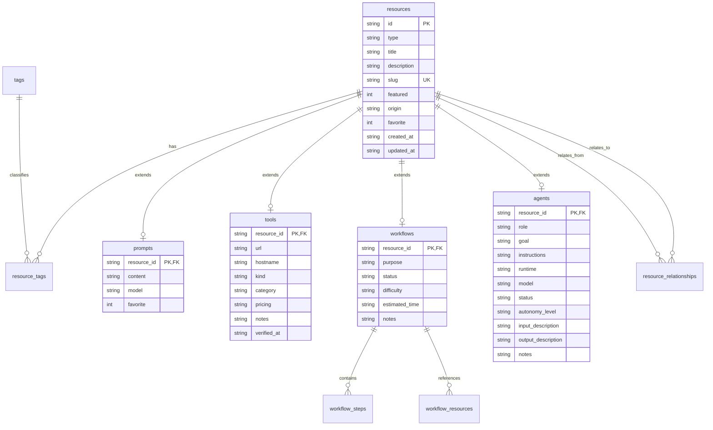

# 08 — Data Architecture & Integrity

## Data Flow & Storage Topology

---

## Data Integrity Evaluation

1. **Foreign Key Enforcement:**
   - Schema defines `ON DELETE CASCADE` across `prompts`, `tools`, `workflows`, `agents`, and join tables (`resource_tags`, `resource_relationships`).
   - SQLite requirement: Must execute `PRAGMA foreign_keys = ON;` per D1 connection to ensure cascading deletes execute properly.
2. **Referential Cycles:**
   - `resource_relationships` allows arbitrary resource-to-resource directed graph relationships (`from_resource_id`, `to_resource_id`, `relationship_type`).
   - No cyclic dependency detection exists at application layer; cycles are tolerated since relationships represent an open knowledge graph.
3. **Data Loss / Truncation Risks:**
   - Text fields are SQLite `TEXT`, which accommodates variable-length UTF-8 strings.
   - However, application layer does not enforce maximum string lengths on incoming JSON bodies, exposing D1 to payload truncation or memory exhaustion if unvalidated multi-megabyte payloads are submitted.
