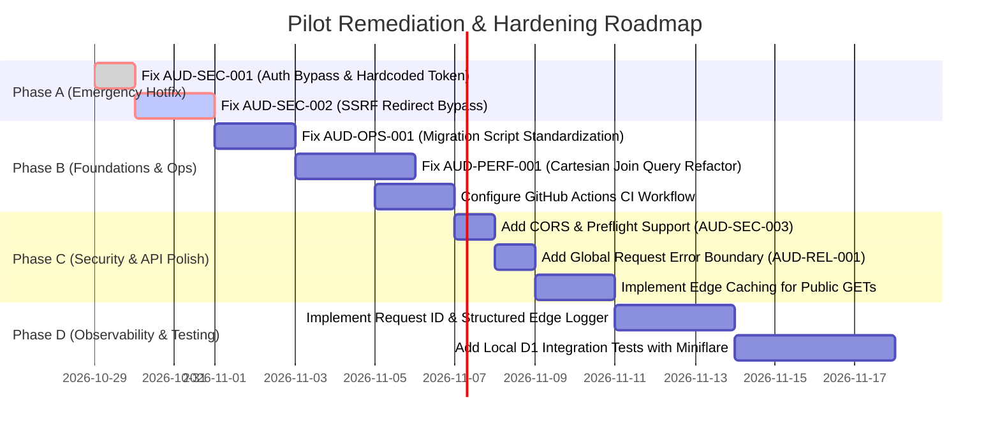

# 31 — Remediation Roadmap & Milestones

## Phased Remediation Plan

---

## Detailed Milestone Objectives

### Phase A: Emergency Hotfix (24-48 Hours) — CRITICAL SAFETY
- **Objective:** Eliminate unauthorized write access and internal SSRF risk.
- **Tasks:**
  1. Patch `src/adapters/http/curatorAuth.ts`:
     - Delete `'pilot_curator_secret_2026'`. Throw or reject if `deps.curatorToken` is absent.
     - Require cryptographic JWT validation for Cloudflare Access before trusting user email headers.
     - Use `crypto.timingSafeEqual` for token comparison.
  2. Patch `src/modules/tools/application/FetchToolMetadataUseCase.ts`:
     - Set `redirect: 'manual'`. Re-validate redirect targets against `isPrivateOrBlockedHost`.

### Phase B: Foundations & Scalability (Sprint 1)
- **Objective:** Fix deployment tooling and prevent D1 database query exhaustion.
- **Tasks:**
  1. Refactor `package.json` migration scripts to use native `wrangler d1 migrations apply`.
  2. Refactor `D1ResourceRepository.list()` SQL query using scalar subqueries to eliminate Cartesian products.
  3. Set up `.github/workflows/ci.yml` running `npm run typecheck` and `npm test` on every pull request.

### Phase C: Edge Caching & API Expansion (Sprint 2)
- **Objective:** Handle 10x-50x traffic scale and support external frontend callers.
- **Tasks:**
  1. Add CORS headers to `/api/*` and handle HTTP `OPTIONS` requests.
  2. Implement Cloudflare Worker Cache API (`caches.default`) with 60-second TTL on public resource listings.
  3. Wrap `router.ts` in a top-level error boundary returning standard JSON error payloads.

### Phase D: Observability & Quality (Sprint 3)
- **Objective:** Production operability and test coverage.
- **Tasks:**
  1. Inject `cf-ray` as `requestId` in response headers and structured logs.
  2. Add D1 integration tests using Miniflare / `@cloudflare/vitest-pool-workers`.
  3. Author an operational disaster recovery runbook in `docs/runbooks/disaster-recovery.md`.
