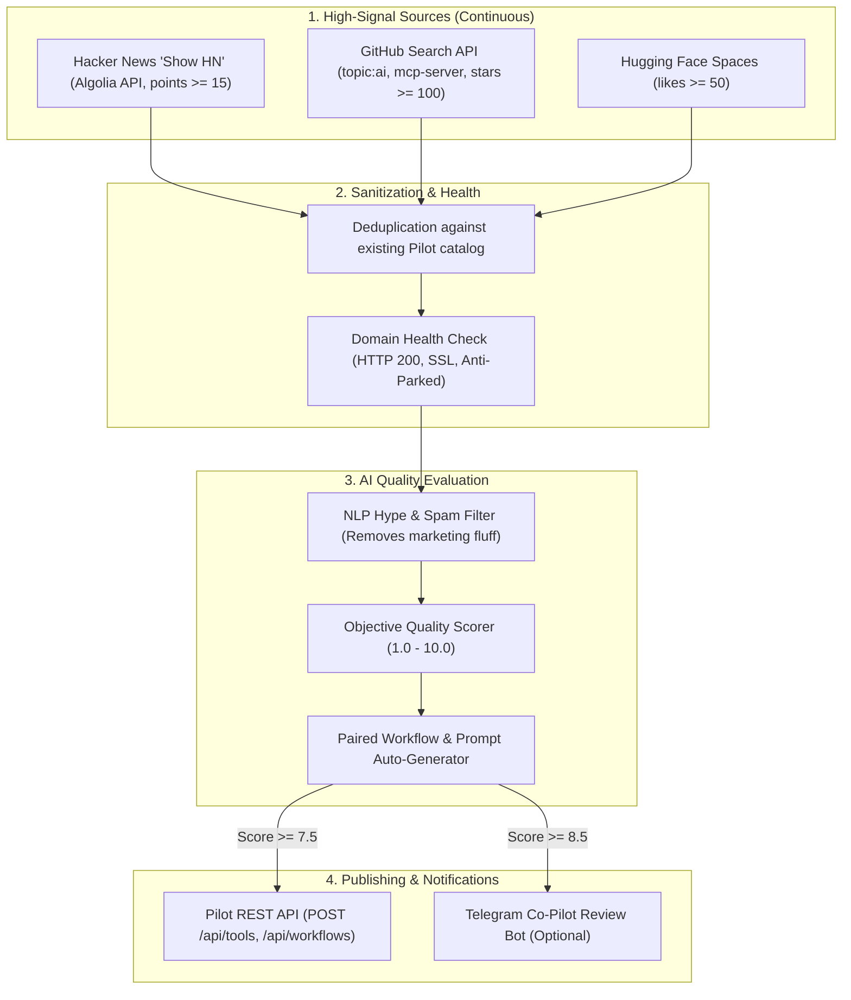

# Autonomous Curation & Content Ingestion Engine

## 1. Overview & Architecture

Pilot features an **Autonomous Curation Pipeline** that continuously discovers, evaluates, enriches, and ingests high-value AI resources without human intervention or manual database editing, while actively preventing low-quality spam.



---

## 2. The 3 Operational Phases

### Phase 1: Core Curation Pipeline (`scripts/auto-curate/`)
- **Location:** [`scripts/auto-curate/`](file:///c:/Users/dangbong/Documents/Projects/Nodbits%20PILOT/scripts/auto-curate)
- **Discovery Sources:**
  - `sources/hackerNews.mjs`: Queries Algolia HN search API for upvoted developer launches.
  - `sources/githubSearch.mjs`: Discovers open-source repositories and MCP servers with stars > 100.
  - `sources/huggingFace.mjs`: Queries trending HF interactive spaces.
- **Sanitization:**
  - `evaluator/domainChecker.mjs`: Verifies live HTTP 200 response, checks SSL, eliminates parked/expired domains.
  - `curatorClient.mjs`: Pre-loads existing catalog tools from Pilot API to ensure zero duplicate entries.
- **Enrichment:**
  - `evaluator/qualityScorer.mjs`: Categorizes into Pilot's taxonomy (`Coding & Dev`, `Agents & Automation`, `Image & Media`, `Chat & Assistants`, `Search & Research`, `Infrastructure`), detects pricing (`Free`, `Freemium`, `Paid`, `Open Source`), and computes an objective score from 1.0 to 10.0.
  - `evaluator/workflowGenerator.mjs`: For high-value tools (score >= 8.0), automatically drafts a practical 3-step Workflow and quickstart Prompt template.

### Phase 2: Automated Scheduled Execution (GitHub Actions)
- **Workflow:** [`.github/workflows/auto-curate.yml`](file:///c:/Users/dangbong/Documents/Projects/Nodbits%20PILOT/.github/workflows/auto-curate.yml)
- **Schedule:** Runs automatically every 6 hours (`0 */6 * * *` UTC) or on-demand via `workflow_dispatch`.
- **Zero Edge Overhead:** Keeps the production Cloudflare Worker lean and fast while utilizing free GitHub Actions runner minutes for deep scraping and LLM processing.

### Phase 3: Telegram Notification & Interactive Co-Pilot Review
- **Module:** [`scripts/auto-curate/notifier/telegramBot.mjs`](file:///c:/Users/dangbong/Documents/Projects/Nodbits%20PILOT/scripts/auto-curate/notifier/telegramBot.mjs)
- **Features:**
  - Instant notification card sent to an admin Telegram channel when new items are auto-published.
  - Optional review cards with interactive inline buttons (`[✅ Approve]`, `[❌ Reject]`) for borderline candidates (score 7.0 - 8.4).

---

## 3. Configuration & Secrets

In your GitHub Repository Settings (**Settings > Secrets and variables > Actions**), configure the following repository secrets:

| Secret Name | Required? | Purpose | Default / Example |
|:---|:---:|:---|:---|
| `CURATOR_TOKEN` | **YES** | Authentication secret for Pilot's REST API (`X-Curator-Key`) | High-entropy string matching Cloudflare secret |
| `PILOT_API_URL` | Optional | Target Pilot production URL | `https://pilot.nodbits.com` |
| `AI_API_KEY` | Optional | Gemini or OpenAI API key for advanced LLM synthesis | (Falls back to local NLP heuristics if omitted) |
| `TELEGRAM_BOT_TOKEN` | Optional | Telegram Bot API token for notifications | From `@BotFather` |
| `TELEGRAM_CHAT_ID` | Optional | Target Telegram channel or user ID | e.g. `-1001234567890` |

---

## 4. Local Execution & Testing

```bash
# Test discovery, deduplication, and quality scoring without writing to production
npm run curate:dry-run

# Test with custom limits and thresholds
node scripts/auto-curate/index.mjs --dry-run --limit=10 --min-score=8.0

# Ingest and publish live into production (requires CURATOR_TOKEN)
CURATOR_TOKEN="your_curator_secret" npm run curate:live
```
